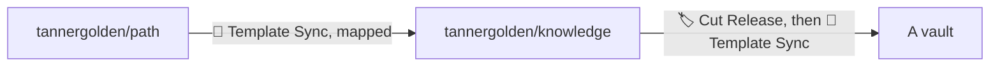

<!--
title: '🌿 HOW A CHANGE REACHES A VAULT'
description: 'The path a change takes from tannergolden/path, the golden path template, through tannergolden/knowledge and its releases, into a vault whose owner runs 🔄 Template Sync, what each section of the sync list means for a vault, and what a sync leaves alone. Read it before you add a file the template ships, cut a release, or merge a sync pull request.'
type: guide
keywords: [template sync, releases, cut release, derived template, versioning, delivery, migration]
-->

<div align="center">

# 🌿 HOW A CHANGE REACHES A VAULT

<a name="top"></a>

**From the golden path template, through a release here, to a pull request in each vault.**

_Two hops, one release, every merge the owner's._

</div>

---

## 💡 Two Hops



**The first hop: the golden path template into this one.** tannergolden/knowledge was generated from
tannergolden/path, the golden path template, and follows it as a template derived from another. A
dispatch of 🔄 Template Sync here takes that template's latest release as a mapped sync, through
`.github/template-derive.json`:

| The mapping  | What it does                                                                                                                                                                                                                                                                                                                                                                                                                                                                                                                                                  |
| :----------- | :------------------------------------------------------------------------------------------------------------------------------------------------------------------------------------------------------------------------------------------------------------------------------------------------------------------------------------------------------------------------------------------------------------------------------------------------------------------------------------------------------------------------------------------------------------ |
| Relocates    | Its `docs/` to `.docs/`, and its `assets/` to `.assets/`                                                                                                                                                                                                                                                                                                                                                                                                                                                                                                      |
| Rewrites     | In `.github/template-sync.md`, `docs/Prompts.md` as `.docs/Prompts.md`, where the page sits here and in every vault                                                                                                                                                                                                                                                                                                                                                                                                                                           |
| Excludes     | What a vault has no use for: `src/`, `tests/`, `packages/`, `benchmarks/` and `examples/`, its changelog, its seed decision record, whose number this template's own records took, and the vulnerability report issue form, which a public repository must not carry; and what this template keeps as its own: the Intelligence Sync stub, and `docs/templates/`, since the vault's document templates are its own ([ADR-0007](https://github.com/tannergolden/knowledge/blob/Development/.docs/adrs/ADR-0007-The-Vault-Keeps-Only-The-Templates-It-Uses.md)) |
| Leaves alone | This template's own `LICENSE`, `.github/actions/README.md` and root `README.md`, the vault's guide; its front page is `.github/README.md`, which GitHub shows ahead of a root `README.md`                                                                                                                                                                                                                                                                                                                                                                     |

`.github/template-derive.lock` records where each file was last synced from. Both files are needed
only here: initialisation deletes them from every vault, so a vault syncs from this template alone.

**The second hop: this template into a vault.** A merge to the default branch here reaches no vault.
🏷️ Cut Release, dispatched with a version `vX.Y.Z`, publishes the release and moves its major, such as
`v2`, to it, after checking that `.github/template-sync` and the Template Sync stub exist and that
`validate-repository.py` passes. Every earlier version stays, page and tag, so a vault that names
one in full in its stub's `ref:` still finds it; tannergolden/intelligence no longer pins one, since
the skills live there now. A vault follows the major its stub's `ref:` names: `v2` for a vault
generated since v2.0.0, `v1` for one generated before. When its owner runs 🔄 Template Sync, every
file the template changed that the vault's list keeps current arrives as one pull request on
`chore/template-sync`, merged with the owner's own changes. A vault never follows a new major until
its owner changes `ref:` in its stub. This template's own stub names `v1` for itself, the major of
tannergolden/path it derives from.

**The universal rules take their own road.** The block between the `INTELLIGENCE` markers in
`AGENTS.md` comes from tannergolden/intelligence, not from the golden path template: this template's
🔁 Intelligence Sync, and every vault's, proposes the hub's latest release as a pull request on
`chore/intelligence`, and leaves the rest of the file alone. Everything below the block, the rules
every AI follows in a personal knowledge vault, reaches a vault by the second hop, like any file its
list keeps current, merged with what its owner added. The block arrives by both roads, and a pull
request that brings a block the vault already has changes nothing in it.

---

## 📋 What A Vault Takes

`.github/template-sync` names every file this template ships, in five sections, then a last one for
the owner's own rules:

| Section                          | In a vault                | What it holds here                                                                                                                                                                                                              |
| :------------------------------- | :------------------------ | :------------------------------------------------------------------------------------------------------------------------------------------------------------------------------------------------------------------------------ |
| Kept current                     | Synced                    | The repository files this template takes from tannergolden/path: the workflow stubs, the repository scripts, the editor and container settings, the community files and forms, and the `.docs/` folder READMEs and prompts page |
| The vault: kept current          | Synced                    | The vault itself: its scripts and action, the root `README.md` and `AGENTS.md`, the landing page, each folder's `README.md` and the scaffolds, the Library, and the `.docs/` pages and document templates written for the vault |
| Yours: seeded once, never synced | Arrives once              | `LICENSE`, `.git-blame-ignore-revs`, `.github/CODEOWNERS`, `.github/FUNDING.yml`, `cut-release.yml` and `.assets/`                                                                                                              |
| The vault: yours                 | Arrives once              | `Memory/Log.md`, `Memory/Dates.md`, the eight flat Profile facets, the catalog and the Intelligence Sync stub                                                                                                                   |
| Only ever in the template        | Deleted at initialisation | The sentinel, the derivation and its lock, and the template's own decision records                                                                                                                                              |

A sync never touches a file the template does not ship, which is every note an owner writes, nor a
file the list leaves to its owner. A file both changed is merged; where both changed the same lines,
the owner's file stays exactly as it was and the pull request shows the template's change. An owner
puts a `#` before a line to keep that file, or writes `# keep mine: /path` under Your rules to keep
their own lines and take the rest. To keep a whole folder the list keeps current, they add two
lines under Your rules, such as `!/Library/Life & Practice/` and `!/Library/Life & Practice/**`. A
folder takes a line of its own beside the one for what it holds, because the sync reads the list with
git's matcher, which cannot switch off a file inside a folder a line above keeps current. [Template Sync](../../.github/template-sync.md) explains every
outcome a sync pull request reports.

---

## 🧰 Adding A File To The Template

For whoever maintains tannergolden/knowledge:

- [ ] **Name it in `.github/template-sync`**, in the same change: under "The vault: kept current" when
      every vault keeps it current, under "The vault: yours" as `#/path` when each owner writes their
      own, or under "Only ever in the template" when no vault needs it. A pattern already there, such
      as `/.docs/technical/vault/**`, may cover it. When you remove a file, remove its line: a line
      naming nothing fails the check.
- [ ] **Make it true in a vault.** A file every vault keeps must still read right once initialisation
      has deleted the template-only files, so it links none of them.
- [ ] **Run the check.** 🔄 Template Sync checks the list on every pull request and every push to the
      default branch here, and fails on a file it does not name. To run it first, from a checkout of
      tannergolden/standards beside this one:

```bash
python3 ../standards/.github/scripts/template-sync.py check --repo-dir .
```

- [ ] **Release it.** Dispatch 🏷️ Cut Release with the next version: until then no vault can take
      the change. A change that renames a file a vault depends on, or reshapes a stub past what a merge
      can carry, is breaking: release it as a new major, which no vault follows until its owner
      decides to.

The full standard for templates, derived ones included, is the standards'
[Template Sync](https://github.com/tannergolden/standards/blob/Development/docs/distribution/automation/Template-Sync.md).

---

## 🚚 Moving A Vault Off Its Own Skills

A vault made before the skills moved to tannergolden/intelligence kept them and their agents itself: the skills in
`.agents/skills/` with a copy in `.claude/skills/` and archives in `System/Skills/`, the venture
workforce in `Ventures/Agent Resources (AR)/`, the Librarian in `Library/`, and
`System/Data/agent-catalog.json`; one older still kept them in `System/Skills/.unpackaged/` and
`Inbox/Faculties/`. The template ships none of them now: every skill and its team live in
tannergolden/intelligence under `kit/skills/`, and the home kit installs them.

- **Install the home kit** on each machine you work from, so the skills keep reaching the vault.
- **Run 🔄 Template Sync.** It removes each of those files you had not changed, and keeps one you had
  changed as yours.
- **On the sync pull request's branch**, carry any change you made to a skill or an agent into your
  own copy of tannergolden/intelligence, or your AI app's own skills folder, then `git rm` what the
  sync kept, empty folders included. Delete `System/Data/agent-catalog.json` too: it was yours, so the
  sync leaves it. Remove the lines under Your rules in `.github/template-sync` that name a skill path,
  such as `!/.agents/skills/<skill>/**`, since they now name nothing.
- Run `python3 .github/scripts/update-vault.py` and commit the catalog it redraws, then merge once
  `python3 .github/scripts/check-vault.py` passes.

---

## 📁 Moving A Vault To Folder READMEs

A vault made before every folder explained itself in a README explained each folder in a note named
after it (`Memory/Memory.md`), kept a `README.md` only in its seven top
folders, and kept its rules in `AGENTS.md`, below the universal rules. Now every folder explains
itself in its `README.md`, written for anyone, the root `README.md` says how to work in the vault, and
`AGENTS.md` keeps the universal rules with the rules every AI follows in a personal knowledge vault,
rewritten to hold an AI to those READMEs. The change renames files every vault keeps current, so it
ships in a new major, v2.0.0: a vault made before it takes it when its owner sets `ref: 'v2'` under
`with:` in `.github/workflows/template-sync.yml`, then runs 🔄 Template Sync.

The same major release carries two more changes. The venture template's `Client Experience (CX)/`
becomes `Customer Experience (CX)/`. And the skills are named as the home kit now names them, twelve
department skills from `administration` to `public-relations`, each covering both a company and the
owner's own life: the root `README.md`, under Where Each Kind Of Work Goes, and each folder's README
give the new names in place of the old ones, such as `board`, `research`, `discover` and `identify`.

- **Run 🔄 Template Sync.** Each folder note the template ships moves to its `README.md`, your
  changes with it, and each top folder's note and README arrive as one `README.md`. A note you had
  changed, and the template removed, stays as yours: `lint-notes.py` names it, as a note named after
  its folder.
- **Merge what stayed.** For each note `lint-notes.py` names, move what it says that the folder's
  `README.md` does not into the README, then `git rm` the note. The same goes for a folder note of
  your own, such as a Library division you added: `git mv` it to that folder's `README.md`.
- **Repoint the links.** A wikilink to an old folder note now resolves to nothing, and
  `check-links.py` names each one: `[[Library/Arts & Recreation/Arts & Recreation|Arts]]` becomes
  `[[Library/Arts & Recreation/README|Arts]]`. It names a plain path to an old folder note too,
  such as `Profile/Profile.md` in `Profile/Biography.md`, where the path is in backticks or on a
  `Related:` line. A name written any other way is not checked: search for each old name and update
  it.
- **Take the new `AGENTS.md`.** The sync merges the template's with yours: the rules below the
  universal block are rewritten, and what you added under a section of your own stays. Where both
  changed the same lines, such as the block, which your 🔁 Intelligence Sync may have moved to a newer
  release, your file stays as it was and the pull request shows the template's: take the template's
  sections below the block, keep your additions and your block, then let the next Intelligence Sync
  bring the block current. Keep `.github/workflows/intelligence-sync.yml`, yours from the start.
- **Rename each venture's own folder.** The sync renames the template's folder, never a venture made
  from it: in each venture, `git mv` its `Client Experience (CX)/` to `Customer Experience (CX)/`,
  give that folder's `README.md` the new name in its title and heading, and update the row in its
  `Human Resources (HR)/Hierarchy.md` and every other mention in your own notes. The files copied
  into a venture are yours too, so the sync leaves the old skill names in them: compare its READMEs,
  its `Administration/` files and its `Cap-Table.md` with the template's, and take the new names.
- Run `python3 .github/scripts/update-vault.py` and commit what it redraws, then merge once
  `python3 .github/scripts/check-vault.py` passes.

---

<div align="center">

**Merged here, released once, taken by each vault when its owner asks.**

[↑ Back to Top](#top)

<br />

Built with ❤️ by the Engineering Team. Distributed under the terms in [LICENSE](/LICENSE).

</div>
