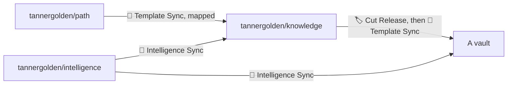

<!--
title: '🌿 HOW A CHANGE REACHES A VAULT'
description: 'The path a change takes from tannergolden/path, the golden path template, through tannergolden/knowledge and its releases, into a vault whose owner runs 🔄 Template Sync, what each section of the sync list means for a vault, and what a sync leaves alone. Read it before you add a file the template ships, cut a release, or merge a sync pull request.'
type: guide
keywords: [template sync, releases, cut release, intelligence sync, derived template, versioning, delivery]
-->

<div align="center">

# 🌿 HOW A CHANGE REACHES A VAULT

<a name="top"></a>

**From the golden path template, through a release here, to a pull request in each vault.**

_Two hops, one release, every merge the owner's._

</div>

---

## 💡 Two Hops & A Side Road



**The first hop: the golden path template into this one.** tannergolden/knowledge was generated from
tannergolden/path, the golden path template, and follows it as a template derived from another. A
dispatch of 🔄 Template Sync here takes that template's latest release as a mapped sync, through
`.github/template-derive.json`:

| The mapping  | What it does                                                                                                                                                                                                                                                         |
| :----------- | :------------------------------------------------------------------------------------------------------------------------------------------------------------------------------------------------------------------------------------------------------------------- |
| Relocates    | Its `docs/` to `.docs/`, and its `assets/` to `.assets/`                                                                                                                                                                                                             |
| Excludes     | What a vault has no use for: `src/`, `tests/`, `packages/`, `benchmarks/` and `examples/`, its changelog, its seed decision record, whose number this template's own records took, and the vulnerability report issue form, which a public repository must not carry |
| Leaves alone | This template's own `LICENSE` and `.github/actions/README.md`, and its front page, `.github/README.md`, which stands in for the template's root `README.md`                                                                                                          |

`.github/template-derive.lock` records where each file was last synced from. Both files are needed
only here: initialisation deletes them from every vault, so a vault syncs from this template alone.

**The second hop: this template into a vault.** A merge to the default branch here reaches no vault.
🏷️ Cut Release, dispatched with a version `vX.Y.Z`, publishes the release and moves `v1` to it, after
checking that `.github/template-sync` and the Template Sync stub exist and that
`validate-repository.py` passes. A vault follows `v1`: when its owner runs 🔄 Template Sync, every file
the template changed that the vault's list keeps current arrives as one pull request on
`chore/template-sync`, merged with the owner's own changes. A vault never follows `v2` until its owner
changes `ref:` in its stub.

**The side road: the universal rules.** 🔁 Intelligence Sync runs every Monday and on request, here
and in every vault. It proposes the latest release of tannergolden/intelligence's block between the
`INTELLIGENCE` markers in `AGENTS.md` as a pull request on `chore/intelligence`, and leaves every
section the repository owns as it was. 🔄 Template Sync passes that sealed block over.

---

## 📋 What A Vault Takes

`.github/template-sync` names every file this template ships, in five sections, then a last one for
the owner's own rules:

| Section                          | In a vault                | What it holds here                                                                                                                                                                             |
| :------------------------------- | :------------------------ | :--------------------------------------------------------------------------------------------------------------------------------------------------------------------------------------------- |
| Kept current                     | Synced                    | The repository files this template takes from tannergolden/path: the workflow stubs, the repository scripts, the editor and container settings, the `.docs/` folder READMEs and seed templates |
| The vault: kept current          | Synced                    | The vault itself: its scripts and action, `AGENTS.md`, the landing page, the folder notes and scaffolds, the Library, the skills, the agent teams and the `.docs/` pages written for the vault |
| Yours: seeded once, never synced | Arrives once              | `LICENSE`, `.git-blame-ignore-revs`, `.github/CODEOWNERS`, `.github/FUNDING.yml`, `cut-release.yml` and `.assets/`                                                                             |
| The vault: yours                 | Arrives once              | The intelligence stub, `Memory/Log.md`, `Memory/Dates.md`, the eight flat Profile facets and the two catalogs                                                                                  |
| Only ever in the template        | Deleted at initialisation | The sentinel, the derivation and its lock, and the template's own decision records                                                                                                             |

A sync never touches a file the template does not ship, which is every note an owner writes, nor a
file the list leaves to its owner. A file both changed is merged; where both changed the same lines,
the owner's file stays exactly as it was and the pull request shows the template's change. An owner
puts a `#` before a line to keep that file, or writes `# keep mine: /path` under Your rules to keep
their own lines and take the rest. To keep a skill of their own, they add five lines under Your
rules, so the skill, its Claude Code copy and its archive all stay theirs: `!/.agents/skills/<skill>/`
and `!/.agents/skills/<skill>/**`, the same two for `.claude/skills/`, and
`!/System/Skills/<skill>.skill`. A folder takes a line of its own beside the one for what it holds,
because the sync reads the list with git's matcher, which cannot switch off a file inside a folder a
line above keeps current. [Template Sync](../../.github/template-sync.md) explains every
outcome a sync pull request reports.

---

## 🧰 Adding A File To The Template

For whoever maintains tannergolden/knowledge:

- [ ] **Name it in `.github/template-sync`**, in the same change: under "The vault: kept current" when
      every vault keeps it current, under "The vault: yours" as `#/path` when each owner writes their
      own, or under "Only ever in the template" when no vault needs it. A pattern already there, such
      as `/.docs/technical/vault/**`, may cover it. When you remove a file, remove its line: a line
      naming nothing fails the check.
- [ ] **Make it true in a vault.** A file every vault keeps must still read right once initialisation
      has deleted the template-only files, so it links none of them.
- [ ] **Run the check.** 🔄 Template Sync checks the list on every pull request and every push to the
      default branch here, and fails on a file it does not name. To run it first, from a checkout of
      tannergolden/standards beside this one:

```bash
python3 ../standards/.github/scripts/template-sync.py check --repo-dir .
```

- [ ] **Release it.** Dispatch 🏷️ Cut Release with the next version: until then no vault can take
      the change. A change that renames a file a vault depends on, or reshapes a stub past what a merge
      can carry, is breaking: release it as a new major, which no vault follows until its owner
      decides to.

The full standard for templates, derived ones included, is the standards'
[Template Sync](https://github.com/tannergolden/standards/blob/Development/docs/distribution/automation/Template-Sync.md).

---

## 🚚 Moving A Vault To v2

v2 moves the skills from `System/Skills/.unpackaged/` to `.agents/skills/`, moves each faculty's
team from `Inbox/Faculties/` into its skill's own `agents/`, and adds Claude Code's copy in
`.claude/skills/` ([ADR-0003](../adrs/ADR-0003-The-Skills-Live-Where-The-Apps-Read-Them.md)). A
vault that kept the template's skills as they came needs only the sync: 🔄 Template Sync moves every
file. A sync does not carry an owner's choice from an old path to a new one, so a vault whose owner
changed the skills takes two steps of its own.

**Before the sync**, in `.github/template-sync`, while the stub still follows the current release:

- If you kept your own skills or teams with a `#` before `/System/Skills/**` or
  `/Inbox/Faculties/**`, take the `#` off, so the sync moves the template's other skills and teams
  to their new homes; deleting those lines instead leaves them behind at the old paths, where
  nothing reads them. Then add, under Your rules, the five lines that keep a skill yours (above)
  for each skill you changed.
- If you deleted a skill, add the same five lines for it, or it comes back at the new paths. Add
  `# keep mine: /System/Skills/Skills.md` too: that note links each skill's archive, and the line
  keeps your copy of it, without the deleted skill's link, which `check-links.py` needs gone.

Commit that, move `ref:` in the stub to `v2`, and run 🔄 Template Sync.

**On the sync pull request's branch**, then merge it as soon as its checks pass: each run of 🔄
Template Sync replaces that branch, so run it again only once you have merged.

- Move each skill you kept to `.agents/skills/<skill>/`, and its team's files into
  `.agents/skills/<skill>/agents/`, from wherever your version is now: its old path, or the commit
  before the sync if the sync took it away. Delete what is left at the old paths, empty folders
  included. Then run `python3 .github/scripts/check-skills.py <skill>` and fix what it reports: v2
  holds every skill to one frontmatter key a line, a description that says "Use when" and read-only
  `allowed-tools`, and each faculty to the hand-over rule.
- Where the sync reports a conflict in a file you edited, move your file to its new path and carry
  in the template's change, which the pull request shows. Then add `# keep mine: /<new path>`
  under Your rules, such as `# keep mine: /.agents/skills/research/agents/Research.md`, or every
  later sync reports the same file again. An `Inbox/Faculties/` note you edited stays behind the
  same way; delete it once nothing you need is left in it.
- Run `python3 .github/scripts/update-vault.py` and commit what it draws: your skills' copies and
  archives, and the two catalogs in `System/Data/`, which are yours, so `check-vault.py` fails
  until they are redrawn.

---

<div align="center">

**Merged here, released once, taken by each vault when its owner asks.**

[↑ Back to Top](#top)

<br />

Built with ❤️ by the Engineering Team. Distributed under the terms in [LICENSE](/LICENSE).

</div>
