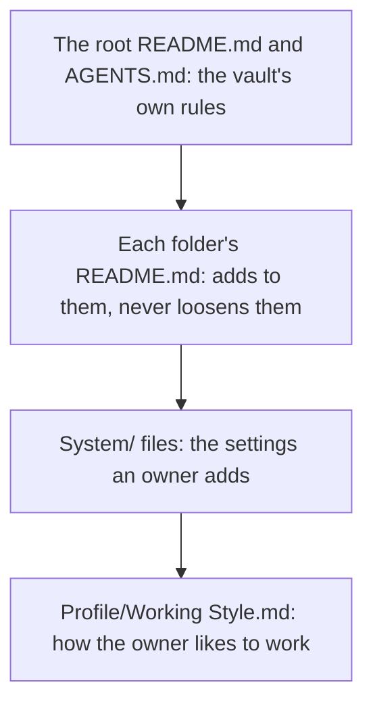
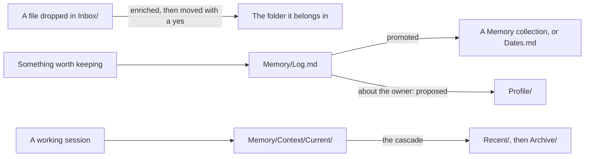

<!--
title: '🧭 HOW THE VAULT WORKS'
description: 'How the parts of a BRAIN vault fit together: where its rules live and which wins, the shapes its notes take, how information moves between folders, where an AI assistant''s own rules and skills come from, and the machinery that checks and redraws it all. Read it first, before any other page here.'
type: guide
keywords: [overview, architecture, readmes, folder readmes, home kit, catalogs, onboarding]
-->

# 🧭 HOW THE VAULT WORKS

**The rules the vault explains, the notes it keeps, and the scripts that check both.**

_Plain files, read in order, checked on every change._

---

## 💡 Three Layers

A vault is plain Markdown in one git repository, in three layers:

| Layer             | What it is                                             | Where it lives                                                                                                               |
| :---------------- | :----------------------------------------------------- | :--------------------------------------------------------------------------------------------------------------------------- |
| **The rules**     | How anyone works here                                  | `AGENTS.md` and the root `README.md`, the `README.md` of each folder, the `System/` settings and `Profile/Working Style.md`  |
| **The notes**     | What the vault knows about its owner and the world     | The seven top folders, each note opening with the hidden frontmatter of the [note schema](../technical/vault/Note-Schema.md) |
| **The machinery** | What checks the notes and draws what derives from them | The scripts in `.github/scripts/`, and the workflows that run them                                                           |

There is no database and no service to run: anyone, and any AI, that can read files reads the vault,
and git history is both its backup and its record of every change.

---

## 📜 The Rules, In The Order They Win

The vault explains itself in README files, written for anyone who works in it, a person or any AI.
The root [`README.md`](../../README.md) is read first: the vault's own rules, how a session goes, the
commands, what done means and where each kind of work goes. Every folder then explains itself in a
`README.md` at its root, which is that folder's note: its purpose, what belongs in it, how to name
and file things there, and its rules. Before anything in a folder is created, edited, moved or
deleted, the README of that folder, and of every folder above it, is read.

Where two disagree, the higher wins, in the order `System/README.md` sets out under Priority Order.
`Profile/Working Style.md` decides every choice the others leave open, which is why each session
reads it first.

An AI reads [`AGENTS.md`](../../AGENTS.md), at the vault root, before anything else, and most AI apps
load it by themselves. It opens with the universal rules every AI follows in any repository, between
`INTELLIGENCE` markers, which [tannergolden/intelligence](https://github.com/tannergolden/intelligence)
renders and 🔁 Intelligence Sync keeps current, with a pull request for each release. Their
Invariants hold everywhere, and nothing waives one; their Defaults give way to the owner's explicit
request, to an entry under the file's Overrides, and to the vault's own rules. Below the block come
the vault's rules for every AI: how a session starts, how personal knowledge is kept private and
true, and what waits for the owner's yes. They hold an AI to the root `README.md` and each folder's
README, and every vault generated from the template starts with them.

---

## 📦 The Shapes A Note Takes

The same few kinds of file recur across the folders. The [Glossary](../references/Glossary.md)
defines each term.

| Shape             | What it is                                                                                                                                                                       | Example                          |
| :---------------- | :------------------------------------------------------------------------------------------------------------------------------------------------------------------------------- | :------------------------------- |
| **Folder README** | The `README.md` at a folder's root, which is the folder's note: its purpose and rules, the only kind of note that may wikilink, and a page in the full format, header and footer | `Memory/README.md`               |
| **Root README**   | The vault's guide, read before any folder's README: a page, not a note                                                                                                           | `README.md`                      |
| **Scaffold**      | A file in a `.template/` folder, copied to make a new note and never edited in place                                                                                             | `Projects/.template/Overview.md` |
| **Collection**    | A folder of one file per entry, whose README lists the entries                                                                                                                   | `Memory/Entities/People/`        |
| **Held sub-home** | A folder of `Inbox/` that is kept, never sorted                                                                                                                                  | `Inbox/Reports/`                 |

A `.template/` folder has a README too. Where its scaffolds are copied one at a time, as in
`Memory/.template/`, the README explains them and is never copied. Where the folder is copied whole,
as a venture's or a project's is, its README is written for the folder it becomes, with the
template's placeholders, and becomes that folder's own.

Each fact has one home. Who the owner is lives in `Profile/` alone; what happened, who is around them,
what they decided and what is due live in `Memory/`; knowledge about the world lives in `Library/`;
their companies live in `Ventures/` and their own initiatives in `Projects/`. The folder READMEs
settle the close calls.

---

## 🔄 How Information Moves

- **The Inbox is sorted first.** A loose file waiting there is sorted before other work: each move
  is proposed with its destination and a clean name, and none is made without a yes
  (`Inbox/README.md`).
- **The Log is where memory lands.** An observation enters `Memory/Log.md` as a dated entry with an
  importance from 1 to 5, then is promoted into its collection or ages out (`Memory/README.md`).
- **Profile changes only with a yes.** What is learned about the owner is proposed, never written on
  inference alone, and a profile interview, such as the `human-resources` skill's, fills it
  (`Profile/README.md`).
- **The Library keeps what lasts.** A holding is filed with a freshness token, and anything that will
  not stay true for five years goes elsewhere (`Library/README.md`).
- **Sessions leave summaries.** A session's summary goes to `Memory/Context/Current/`, and
  `update-vault.py` moves the oldest down the tiers as they fill:
  [Sessions & The Memory Cascade](../technical/vault/Sessions-&-The-Memory-Cascade.md) has the whole
  lifecycle.

---

## 🤖 AI Assistants & Skills

An AI assistant works in the vault the way a person does, after reading `AGENTS.md`: it reads the
root `README.md`, then the README of each folder it works in. The vault holds no skills, no agent
specs and no file for any one AI app: `AGENTS.md` is the one file every app shares, and most load it
by themselves. The skills an assistant may bring are twelve, one for each department and named for
it: `administration`, `finance-and-accounting`, `legal-and-compliance`, `sales-and-marketing`,
`operations-and-logistics`, `human-resources`, `information-technology`, `research-and-development`,
`business-intelligence`, `quality-assurance`, `customer-experience` and `public-relations`. Each
covers both a company the owner runs and the owner's own life. They live in
[tannergolden/intelligence](https://github.com/tannergolden/intelligence) under `kit/skills/`, and
the home kit installs them, with the universal rules, into each AI app on every machine and in every
Claude Code cloud session.

The skills are universal: they hardcode no vault path, and each reads a repository's `AGENTS.md`
before it writes anything there. `AGENTS.md` sends it to the root `README.md`, whose Where Each Kind
Of Work Goes gives this vault's layout to whoever writes here: for each skill, where a company's
records go in its venture folder and where its work in the owner's own life goes, where reports,
ideas and visuals are held, how the Profile is filled, and which checks run after a write. Each of
those folders' own README says which skill's work lands there and by what rules.

---

## ⚙️ The Machinery

Some text in the vault is drawn by a machine and never edited by hand: change its source, then redraw.

| Machine-owned                                                                                                  | Drawn by                                  | When                                                     |
| :------------------------------------------------------------------------------------------------------------- | :---------------------------------------- | :------------------------------------------------------- |
| The blocks between `brain:` markers, the memory cascade, the catalog in `System/Data/`, the `.gitkeep` markers | `python3 .github/scripts/update-vault.py` | After a change, run by whoever made it                   |
| The folder logs between `AUTO-INDEX` markers                                                                   | 🗂️ Machined Indexes                       | After each push to the default branch, as a pull request |

`python3 .github/scripts/check-vault.py` runs every vault check: the notes, the links, the scan for
personal numbers, the files git ignores and the generated parts. 🧠 Vault runs it, with the scripts'
own tests, on every pull request and every push to the default branch, in the template as in every
vault.
[Vault Scripts](../technical/Vault-Scripts.md) says how the scripts fit together and what to do when
one fails.

---

## 🌿 What Keeps It Current

Three automations keep it current, each as a pull request the owner merges, and none pushes to a
branch:

- **🔄 Template Sync**, when the owner runs it, carries the template's released fixes, from the
  latest release of the major its stub follows: `v2` for a vault generated now.
- **🔁 Intelligence Sync**, every Monday, brings the universal rules of each new
  tannergolden/intelligence release into the block at the top of `AGENTS.md`.
- **🗂️ Machined Indexes**, after each push to the default branch, redraws the folder logs.

A sync never touches a note the template does not ship, nor a file the list leaves to the owner,
such as `Memory/Log.md` and `Profile/Working Style.md`. The skills change with the home kit, outside
the repository.
[How A Change Reaches A Vault](../distribution/How-A-Change-Reaches-A-Vault.md) follows a change from
its first commit to a vault.

---

## 🔗 See also

- [Setting Up A Vault](Setting-Up-A-Vault.md) - from generating a vault to its first session
- [Working In The Vault](Working-In-The-Vault.md) - the rules a change is held to, and what to run before a push
- [Vault reference](../technical/vault/README.md) - the note schema, the keywords, the link topology, context assembly and sessions
- [Glossary](../references/Glossary.md) - the vault's own terms, each with where it is defined

---

**Rules read first, notes kept plain, and a script behind every promise.**

[↑ Back to Top](#top)

 

Built with ❤️ by the Engineering Team. Distributed under the terms in [LICENSE](/LICENSE).

