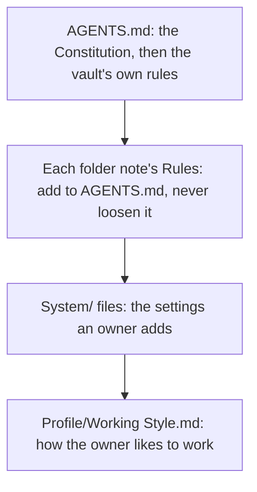
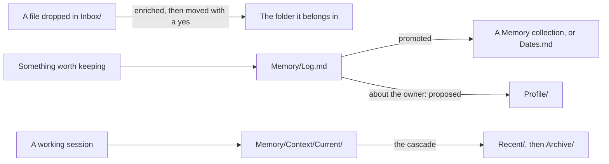

<!--
title: '🧭 HOW THE VAULT WORKS'
description: 'How the parts of a BRAIN vault fit together: the rules an agent reads and which wins, the shapes its notes take, how information moves between folders, the skills and their agent teams, and the machinery that checks and redraws it all. Read it first, before any other page here.'
type: guide
keywords: [overview, architecture, agents-md, folder notes, skills, catalogs, onboarding]
-->

# 🧭 HOW THE VAULT WORKS

**The rules an agent reads, the notes it keeps, and the scripts that check both.**

_Plain files, read in order, checked on every change._

---

## 💡 Three Layers

A vault is plain Markdown in one git repository, in three layers:

| Layer             | What it is                                             | Where it lives                                                                                                               |
| :---------------- | :----------------------------------------------------- | :--------------------------------------------------------------------------------------------------------------------------- |
| **The rules**     | How an agent works here                                | `AGENTS.md`, the Rules in each folder note, the `System/` settings and `Profile/Working Style.md`                            |
| **The notes**     | What the vault knows about its owner and the world     | The seven top folders, each note opening with the hidden frontmatter of the [note schema](../technical/vault/Note-Schema.md) |
| **The machinery** | What checks the notes and draws what derives from them | The scripts in `.github/scripts/`, and the workflows that run them                                                           |

There is no database and no service to run: any agent that can read files reads the vault, and git
history is both its backup and its record of every change.

---

## 📜 The Rules, In The Order They Win

[`AGENTS.md`](../../AGENTS.md) is the one root file every agent reads first. Its sealed block, between
the `INTELLIGENCE` markers, is the universal Constitution from
[tannergolden/intelligence](https://github.com/tannergolden/intelligence), which 🔁 Intelligence Sync
keeps current and nobody edits by hand; the sections after it are the vault's own rules. Each top
folder's note opens with that folder's Rules, and before an agent creates, edits, moves or deletes
anything in a folder, it reads the Rules in that folder's note and in every folder note above it.

Where two disagree, the higher wins, in the order `System/System.md` sets out under Priority Order.
`Profile/Working Style.md` decides every choice the others leave open, which is why each session
reads it first.

---

## 📦 The Shapes A Note Takes

The same few kinds of file recur across the folders. The [Glossary](../references/Glossary.md)
defines each term.

| Shape             | What it is                                                                                                        | Example                                          |
| :---------------- | :---------------------------------------------------------------------------------------------------------------- | :----------------------------------------------- |
| **Folder note**   | The note named after its folder: the folder's Rules and how it works, and the only kind of note that may wikilink | `Memory/Memory.md`                               |
| **README**        | A top folder's GitHub page; only the seven top folders carry one                                                  | `Memory/README.md`                               |
| **Scaffold**      | A file in a `.template/` folder, copied to make a new note and never edited in place                              | `Projects/.template/Overview.md`                 |
| **Collection**    | A folder of one file per entry, whose folder note lists the entries                                               | `Memory/Entities/People/`                        |
| **Held sub-home** | A folder of `Inbox/` that is kept, never sorted                                                                   | `Inbox/Reports/`                                 |
| **Agent spec**    | One agent, opening with the `---` block its loader reads                                                          | `.agents/skills/research/agents/Fact-Checker.md` |

Each fact has one home. Who the owner is lives in `Profile/` alone; what happened, who is around them,
what they decided and what is due live in `Memory/`; knowledge about the world lives in `Library/`;
their companies live in `Ventures/` and their own initiatives in `Projects/`. The folder notes settle
the close calls.

---

## 🔄 How Information Moves

- **The Inbox is sorted first.** A loose file waiting there is sorted before other work: each move
  is proposed with its destination and a clean name, and none is made without a yes
  (`Inbox/Inbox.md`).
- **The Log is where memory lands.** An observation enters `Memory/Log.md` as a dated entry with an
  importance from 1 to 5, then is promoted into its collection or ages out (`Memory/Memory.md`).
- **Profile changes only with a yes.** What an agent learns about its owner is proposed, never
  written on inference alone, and the `identify` skill interviews the owner to fill it
  (`Profile/Profile.md`).
- **The Library keeps what lasts.** A holding is filed with a freshness token, and anything that will
  not stay true for five years goes elsewhere (`Library/Library.md`).
- **Sessions leave summaries.** A session's summary goes to `Memory/Context/Current/`, and
  `update-vault.py` moves the oldest down the tiers as they fill:
  [Sessions & The Memory Cascade](../technical/vault/Sessions-&-The-Memory-Cascade.md) has the whole
  lifecycle.

---

## 🤖 Skills & Agent Teams

The vault's seven skills live in `.agents/skills/<name>/`, where Codex, Copilot, Cursor, Gemini and
Antigravity read a repository's skills. `update-vault.py` copies each into `.claude/skills/<name>/`
for Claude Code, which reads nothing under `.agents/`, and builds its `<name>.skill` archive in
`System/Skills/` for the Claude app. An agent fires the skill whose description matches the request,
without asking. A skill names its team in its `metadata.team`: a faculty keeps that team in its own
`agents/` folder, and `board` and `identify` call on a department of the venture workforce.

| Skill       | Dispatches                   | From                             |
| :---------- | :--------------------------- | :------------------------------- |
| `board`     | Administration               | `Ventures/Agent Resources (AR)/` |
| `discover`  | Discovery                    | Its own `agents/`                |
| `editorial` | Editorial                    | Its own `agents/`                |
| `finance`   | Finance                      | Its own `agents/`                |
| `identify`  | Research & Development (R&D) | `Ventures/Agent Resources (AR)/` |
| `research`  | Research                     | Its own `agents/`                |
| `visualize` | Design                       | Its own `agents/`                |

The faculties' teams, the venture workforce and `Library/`, where the Librarian works alone, make one
library with one namespace:
no two agents share a spoken name or a role, and `System/Data/agent-catalog.json` lists them all. A team is
the specs in its folder, led by the one whose file name carries a star. A lead orchestrates and holds
only `Read`, `Grep`, `Glob` and `Task`, and no agent but the Librarian holds `Write` or `Edit`, so the
skill that dispatched a team writes what the team returns. `develop`, which builds and fixes skills,
is universal: it comes from tannergolden/intelligence, and the vault keeps no copy. The five faculties
travel from here the other way: the home kit carries a copy pinned to a release of this template to
every repository on its owner's machines, and in a vault that copy hands over to the vault's own.

---

## ⚙️ The Machinery

Some text in the vault is drawn by a machine and never edited by hand: change its source, then redraw.

| Machine-owned                                                                                                                                                       | Drawn by                                  | When                                                     |
| :------------------------------------------------------------------------------------------------------------------------------------------------------------------ | :---------------------------------------- | :------------------------------------------------------- |
| The blocks between `brain:` markers, the memory cascade, both catalogs in `System/Data/`, the `.skill` archives, the `.claude/skills/` copy, the `.gitkeep` markers | `python3 .github/scripts/update-vault.py` | After a change, run by the agent or the owner            |
| The folder logs between `AUTO-INDEX` markers                                                                                                                        | 🗂️ Machined Indexes                       | After each push to the default branch, as a pull request |
| The block between the `INTELLIGENCE` markers in `AGENTS.md`                                                                                                         | 🔁 Intelligence Sync                      | Every Monday and on request, as a pull request           |

`python3 .github/scripts/check-vault.py` runs every vault check: the notes, the links, the skills, the
agents, the scan for personal numbers and the generated parts. 🧠 Vault runs it, with the scripts' own
tests, on every pull request and every push to the default branch, in the template as in every vault.
[Vault Scripts](../technical/Vault-Scripts.md) says how the scripts fit together and what to do when
one fails.

---

## 🌿 What Keeps It Current

Three automations bring change from outside, each as a pull request the owner merges, and none
pushes to a branch: 🔄 Template Sync, when the owner runs it, carries the template's released fixes;
🔁 Intelligence Sync carries the universal rules; 🗂️ Machined Indexes redraws the folder logs. A sync
never touches a note the template does not ship, nor a file the list leaves to the owner, such as
`Memory/Log.md` and `Profile/Working Style.md`.
[How A Change Reaches A Vault](../distribution/How-A-Change-Reaches-A-Vault.md) follows a change from
its first commit to a vault.

---

## 🔗 See also

- [Setting Up A Vault](Setting-Up-A-Vault.md) - from generating a vault to its first session
- [Working In The Vault](Working-In-The-Vault.md) - the rules a change is held to, and what to run before a push
- [Vault reference](../technical/vault/README.md) - the note schema, the keywords, the link topology, context assembly and sessions
- [Glossary](../references/Glossary.md) - the vault's own terms, each with where it is defined

---

**Rules read first, notes kept plain, and a script behind every promise.**

[↑ Back to Top](#top)

 

Built with ❤️ by the Engineering Team. Distributed under the terms in [LICENSE](/LICENSE).

