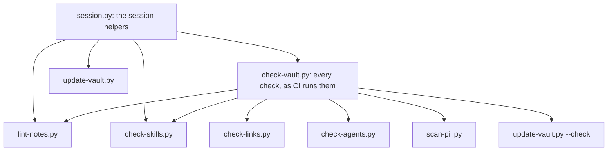

<!--
title: '🔧 VAULT SCRIPTS'
description: 'How the scripts in .github/scripts/ fit together: the library they share, the contract each one keeps, what each check fails on, what update-vault.py draws and where, how they are tested and where CI runs them, and what to do when one fails. Read it before you change a script, or when a check fails.'
type: guide
keywords: [python, checks, generator, generated blocks, catalogs, continuous integration, troubleshooting, exit codes]
-->

<div align="center">

# 🔧 VAULT SCRIPTS

<a name="top"></a>

**How the checks and the generator fit together, and what to do when one of them fails.**

_One library, one contract, every script under test._

</div>

---

## 💡 How They Fit Together

Every vault script imports `vault.py`, the library beside it, so no two scripts can disagree about
what a note says: where things live, how frontmatter reads, what the schema allows, how a wikilink
resolves, and how a generated block is found and redrawn. Two scripts run the others, each as a
subprocess:



`profile-coverage.py`, whose `--json` report the `identify` skill reads, and `knowledge-base.py`, for
the offline reference works, stand alone. `validate-repository.py`, `verify-stub-ceilings.py` and the
git hooks in `hooks/` are not vault scripts: they check the repository's own configuration and each
commit, and this template takes them, with the workflow stubs, from tannergolden/path, the golden
path template it follows. The
[scripts' folder log](../../.github/scripts/README.md) gives each file's purpose, and
[Sessions & The Memory Cascade](vault/Sessions-&-The-Memory-Cascade.md) covers `session.py`.

---

## ⚙️ The Contract Each Script Keeps

- **It finds the vault itself.** The root is two folders above the script, and `--root` points it at
  another vault, which is how the tests run it. Nothing holds an absolute path.
- **Standard library only, on Python 3.9.** Each opens with `from __future__ import annotations`,
  and a test fails a vault script that does not.
- **One finding to a line.** `error: <path>:<line>: <message>` or `warning: ...`, then a count; under
  GitHub Actions each finding is also an annotation on its file.
- **Exit codes say what happened.** 0 when clean, 1 on findings, 2 on misuse, such as a file or a
  skill that does not exist.
- **Only the generator writes.** `vault.py` and every check only read, and `update-vault.py` writes
  nothing under `--check`. `knowledge-base.py` writes only its `sources.json` and the reference works
  it downloads, and removes an older build only with a yes or `--yes`.
- **Output is deterministic.** Sorted, with no timestamps, so CI can always tell a stale file from a
  fresh one, and a second run changes nothing.

A new script follows the same rules, which `System/System.md` sets out under Writing Scripts.

---

## 🛡️ What Each Check Fails On

| Script                    | Fails on                                                                                                                                                                                                                                                                                                                                                                                                                                                                                                                                                                                                                                                                                                  | Warns on                                                                   | The rule                                                                           |
| :------------------------ | :-------------------------------------------------------------------------------------------------------------------------------------------------------------------------------------------------------------------------------------------------------------------------------------------------------------------------------------------------------------------------------------------------------------------------------------------------------------------------------------------------------------------------------------------------------------------------------------------------------------------------------------------------------------------------------------------------------- | :------------------------------------------------------------------------- | :--------------------------------------------------------------------------------- |
| `lint-notes.py`           | A note with no hidden frontmatter; a missing `title`, `description` or `type`; a type outside the six; a retired or unknown field; a bad `status` or `keywords`; an empty note, an `_` in a file name, an em dash, a callout beyond GitHub's five alerts, a wikilink in a scaffold; a Library holding without exactly one freshness token; a `README.md` outside the seven top folders                                                                                                                                                                                                                                                                                                                    | Nothing                                                                    | [Note Schema](vault/Note-Schema.md), [Keywords](vault/Keywords.md)                 |
| `check-links.py`          | A wikilink to no file or into a scaffold, one the hub topology does not allow, and two notes that link each other                                                                                                                                                                                                                                                                                                                                                                                                                                                                                                                                                                                         | A link that matches several files, and a cycle through more than two notes | [Link Topology](vault/Link-Topology.md)                                            |
| `check-skills.py`         | A skill in `.agents/skills/` that breaks the Agent Skills format, the home kit's stricter reading of it, or the vault's layout: its `SKILL.md` fields, each on one line and parseable as YAML, a description that says "Use when", read-only `allowed-tools` and no backslash in the body outside inline code; `License.txt`, `Changelog.md`, namesake doc, `assets/`, `references/` and `templates/`; a `scripts/` folder, a file two folders deep, or one that is not text; an `agents/` that holds any team but its own, or a faculty without the hand-over rule word for word; a `metadata.team` no roster defines; a version that differs from the Changelog's; no `## Boundaries`; an en or em dash | An `_` in its folder name, and a wikilink in its files                     | `System/Skills/Skills.md`                                                          |
| `check-agents.py`         | A spec without its `name`, its `description` or one of its nine sections; a lead whose tools are not exactly `Read`, `Grep`, `Glob` and `Task` (the Librarian holds `Write`, `Edit` and `Bash` too); any other agent holding `Write` or `Edit`; a team without a roster (a skill's `agents/` holds exactly one), or without exactly one starred lead; a role or spoken name used twice                                                                                                                                                                                                                                                                                                                    | An Identity section without its Name, Persona and Voice lines              | `System/Skills/Skills.md`, `Ventures/Agent Resources (AR)/Agent Resources (AR).md` |
| `scan-pii.py`             | A Social Security number, or a 13 to 19 digit number that opens with 3 to 6 and passes the Luhn check, in a text file git tracks; JSON files are spared the number checks, and a line holding `pii-allow` is skipped                                                                                                                                                                                                                                                                                                                                                                                                                                                                                      | Nothing                                                                    | [Personal Data & Secrets](../operations/Personal-Data-&-Secrets.md)                |
| `update-vault.py --check` | Anything the generator would change, and anything it cannot draw: a note that has lost its block's markers, an archive with no source, a team its skill names that no roster defines                                                                                                                                                                                                                                                                                                                                                                                                                                                                                                                      | Nothing                                                                    | The table below                                                                    |

---

## 📦 What update-vault.py Draws

It takes six steps in order, each from the notes as they stand:

| Step                      | Draws                                                                                                                                                            | Where                                                                                                                                             |
| :------------------------ | :--------------------------------------------------------------------------------------------------------------------------------------------------------------- | :------------------------------------------------------------------------------------------------------------------------------------------------ |
| 1. The memory cascade     | Moves the oldest summary down a tier while one is over its cap                                                                                                   | `Memory/Context/`, as [Sessions & The Memory Cascade](vault/Sessions-&-The-Memory-Cascade.md) says                                                |
| 2. The generated blocks   | `tier-summaries`: each tier's summaries                                                                                                                          | `Memory/Context/Current/Current.md` and `Memory/Context/Recent/Recent.md`                                                                         |
|                           | `collection-entries`: each collection's entries                                                                                                                  | The notes of `People/`, `Organizations/` and `Places/` in `Memory/Entities/`, and of `Memory/Decisions/`, `Memory/Events/` and `Memory/Insights/` |
|                           | `profile-entries`: each folder facet's entries                                                                                                                   | The notes of `Profile/Values/`, `Profile/Goals/`, `Profile/Skills/` and `Profile/Health/`                                                         |
|                           | `open-loops`: every Log entry still marked `**Status:** Open`                                                                                                    | `Memory/Log.md`                                                                                                                                   |
|                           | `children`: links to the notes of a folder's subfolders                                                                                                          | Any folder note that carries the markers                                                                                                          |
| 3. The catalogs           | One record per note but the scaffolds, sorted by path; every agent and team in the three homes, with counts                                                      | `System/Data/catalog.ndjson` and `System/Data/agent-catalog.json`                                                                                 |
| 4. The skill archives     | Each source zipped, its namesake doc without the vault's frontmatter, with its own `agents/`, or else the team its `metadata.team` names vendored into `agents/` | `System/Skills/<name>.skill`                                                                                                                      |
| 5. The skill copy         | Every file of `.agents/skills/`, byte for byte, for Claude Code, which reads nothing under `.agents/`; a file no source holds is removed                         | `.claude/skills/`                                                                                                                                 |
| 6. The `.gitkeep` markers | One in each empty folder, and none where a folder has files                                                                                                      | Every folder the vault walks                                                                                                                      |

A block sits between `<!-- brain:NAME (drawn by .github/scripts/update-vault.py - do not edit by hand) -->`
and `<!-- /brain:NAME -->`, and only this script writes inside one. A note the vault requires a block
in fails when it has lost the markers: put them back and run it again. The `<!-- brain:log-entries -->`
line in `Memory/Log.md` is not a block: it marks where the next Log entry goes. An archive is compared
by what it holds, never by its bytes, and every entry in it carries the same fixed date, so a rebuild
on another machine counts as unchanged.

---

## 🧪 How They Are Tested

Each script has a `test_<name>.py` beside it, which `unittest` finds on its own:

```bash
python3 -m unittest discover -s .github/scripts -p 'test_*.py'
```

`fixtures.py` builds a throwaway vault in a temporary folder, a note with valid frontmatter from one
call, and the tests run the real script on it with `--root`, as CI does, so a test never touches the
vault in the repository. A few tests read the real vault on purpose: that it passes every check, that
nothing generated is stale, and that the wiring holds. The 🧠 Vault action must run scripts that
exist, its workflow must carry no template guard, `check-vault.py` must run every check, and every
script must open with a one-line purpose and hold no en or em dash. The tests keep their underscores
because `unittest` imports each one as a module.

---

## 🚀 Where CI Runs Them

| Workflow                | Runs                                                                                                                                             | When                                                                                                                         |
| :---------------------- | :----------------------------------------------------------------------------------------------------------------------------------------------- | :--------------------------------------------------------------------------------------------------------------------------- |
| 🧠 Vault                | `check-vault.py`, then the scripts' tests, through the action in `.github/actions/vault/`                                                        | Every pull request, every push to the default branch, and by hand, with no template guard, in the template as in every vault |
| 🚦 Checks               | `validate-repository.py` as its lint, the scripts' tests, the frontmatter check in `enforce` mode, the secret scan, CodeQL and the workflow lint | Pull requests, pushes to the default branch, and a sweep every Monday at 03:00 UTC                                           |
| 🔬 Verify Stub Ceilings | `verify-stub-ceilings.py`, against the standards at `v1`                                                                                         | A change under `.github/workflows/`, and daily                                                                               |
| 🏷️ Cut Release          | `validate-repository.py`, at the commit about to be tagged                                                                                       | Each release of the template                                                                                                 |

---

## 🩺 When A Check Fails

Each finding names its file and says what to change. The common ones:

| The finding says                                               | Do this                                                                                                                  |
| :------------------------------------------------------------- | :----------------------------------------------------------------------------------------------------------------------- |
| `run python3 .github/scripts/update-vault.py`                  | Run it, read the diff, and commit what it redrew                                                                         |
| `no frontmatter block`, `missing field`                        | Open the note with the hidden block from the [Note Schema](vault/Note-Schema.md)                                         |
| `is retired (Note-Schema.md); remove the line`                 | Remove the field: the path or git already says it                                                                        |
| `resolves to no file`                                          | Point the link at a file that exists, or name the file by plain path                                                     |
| `carries no wikilinks; name the file by plain path`            | Write the path in backticks instead: only a folder note links                                                            |
| `link each other`                                              | Keep the link in the note nearer the root, and name the other by plain path                                              |
| `carries one freshness token`                                  | Lead the holding's keywords with exactly one `freshness/` token                                                          |
| `a README.md belongs only in the seven top folders`            | Move what it says into the folder's own note, then delete it, with a yes                                                 |
| `looks like a Social Security number`, `a payment card number` | Replace the value with a pointer to where it lives; a reviewed false positive takes `pii-allow` in a comment on its line |
| `has no <!-- brain:NAME --> block`                             | Put the block's start and end markers back in the note                                                                   |
| `has no source in .agents/skills/`                             | Restore the source, or delete the archive, with a yes                                                                    |
| `quote the description value`                                  | Wrap the value in double quotes: YAML reads a `: ` or a ` #` inside a plain value as structure                           |
| `allowed-tools pre-approves read-only tools only`              | Drop the tools that write, run commands or start agents; the session's own permissions cover them                        |
| `em dash`                                                      | Use a comma, a colon, parentheses or a spaced hyphen                                                                     |

---

<div align="center">

**One library to read the vault, one script to redraw it, the same checks everywhere.**

[↑ Back to Top](#top)

<br />

Built with ❤️ by the Engineering Team. Distributed under the terms in [LICENSE](/LICENSE).

</div>
