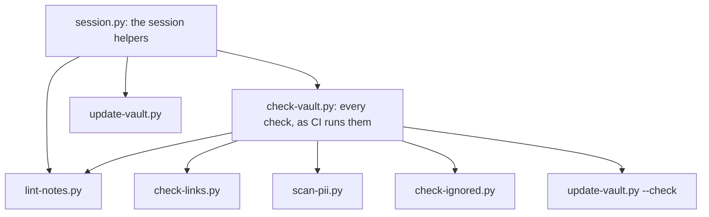

<!--
title: '🔧 VAULT SCRIPTS'
description: 'How the scripts in .github/scripts/ fit together: the library they share, the contract each one keeps, what each check fails on, what update-vault.py draws and where, how they are tested and where CI runs them, and what to do when one fails. Read it before you change a script, or when a check fails.'
type: guide
keywords: [python, checks, generator, generated blocks, catalogs, continuous integration, troubleshooting, exit codes]
-->

<div align="center">

# 🔧 VAULT SCRIPTS

<a name="top"></a>

**How the checks and the generator fit together, and what to do when one of them fails.**

_One library, one contract, every script under test._

</div>

---

## 💡 How They Fit Together

Every vault script imports `vault.py`, the library beside it, so no two scripts can disagree about
what a note says: where things live, how frontmatter reads, what the schema allows, how a wikilink
resolves, and how a generated block is found and redrawn. Two scripts run the others, each as a
subprocess:



`profile-coverage.py`, whose `--json` report the profile interview reads,
and `knowledge-base.py`, for the offline reference works, stand alone. `validate-repository.py`,
`verify-stub-ceilings.py` and the git hooks in `hooks/` are not vault scripts: they check the
repository's own configuration and each commit, and this template takes them, with the workflow
stubs, from tannergolden/path, the golden path template it follows. The
[scripts' folder log](../../.github/scripts/README.md) gives each file's purpose, and
[Sessions & The Memory Cascade](vault/Sessions-&-The-Memory-Cascade.md) covers `session.py`.

---

## ⚙️ The Contract Each Script Keeps

- **It finds the vault itself.** The root is two folders above the script, and `--root` points it at
  another vault, which is how the tests run it. Nothing holds an absolute path.
- **It reads what git would commit.** Inside a checkout the walk leaves out whatever git ignores, so
  the machine that holds an ignored folder and a fresh checkout lint, link and catalog the same
  notes. Of the folders git does keep, it skips the hidden ones other than `.template/`, and
  `Inbox/Backups/`, by its path: a folder named `Backups` anywhere else is an ordinary folder.
- **Standard library only, on Python 3.9.** Each opens with `from __future__ import annotations`,
  and a test fails a vault script that does not.
- **One finding to a line.** `error: <path>:<line>: <message>` or `warning: ...`, then a count; under
  GitHub Actions each finding is also an annotation on its file.
- **Exit codes say what happened.** 0 when clean, 1 on findings, 2 on misuse, such as a file that
  does not exist.
- **Only the generator writes.** `vault.py` and every check only read, and `update-vault.py` writes
  nothing under `--check`. `knowledge-base.py` writes only its `sources.json` and the reference works
  it downloads, and removes an older build only with a yes or `--yes`.
- **Output is deterministic.** Sorted, with no timestamps, so CI can always tell a stale file from a
  fresh one, and a second run changes nothing.

A new script follows the same rules, which `System/README.md` sets out under Writing Scripts.

---

## 🛡️ What Each Check Fails On

| Script                    | Fails on                                                                                                                                                                                                                                                                                                                                                                                                                                                                                                                | Warns on                          | The rule                                                            |
| :------------------------ | :---------------------------------------------------------------------------------------------------------------------------------------------------------------------------------------------------------------------------------------------------------------------------------------------------------------------------------------------------------------------------------------------------------------------------------------------------------------------------------------------------------------------- | :-------------------------------- | :------------------------------------------------------------------ |
| `lint-notes.py`           | A note with no hidden frontmatter, or one fenced with `---`; a missing `title`, `description` or `type`; a type outside the six; a retired or unknown field; a bad `status` or `keywords`; an empty note, an `_` in a file name, an em dash, a callout beyond GitHub's five alerts, a wikilink in a scaffold; a Library holding without exactly one freshness token; a note named after its folder, which repeats the folder's `README.md`; a folder's `README.md` without the page format's centered header and footer | Nothing                           | [Note Schema](vault/Note-Schema.md), [Keywords](vault/Keywords.md)  |
| `check-links.py`          | A wikilink to no file or into a scaffold, or one the hub topology does not allow; a plain path that names no file or folder, on a `Related:` line or in backticks from a top folder and ending in `.md` or a slash                                                                                                                                                                                                                                                                                                      | A link that matches several files | [Link Topology](vault/Link-Topology.md)                             |
| `scan-pii.py`             | A Social Security number, or a 13 to 19 digit number that opens with 3 to 6 and passes the Luhn check, unbroken or in a card's groups joined by spaces or hyphens, in a text file git tracks or would commit; JSON files are spared the number checks, an `.html` or `.svg` page is read as its visible text, and a line holding `pii-allow` is skipped                                                                                                                                                                 | Nothing                           | [Personal Data & Secrets](../operations/Personal-Data-&-Secrets.md) |
| `check-ignored.py`        | A file or folder under the seven top folders that a rule the vault's `.gitignore` inherited for code hides from git: one above its `BRAIN Vault` line, such as `build/`, `test-results/`, `*.zip` or `*.key`. What the vault's own rules hide, what a `.gitignore` in the file's own folder hides, and junk (dot files, `__pycache__/`, `node_modules/`) pass                                                                                                                                                           | Nothing                           | [How The Vault Works](../introduction/How-The-Vault-Works.md)       |
| `update-vault.py --check` | Anything the generator would change, and anything it cannot draw: a note that has lost its block's markers                                                                                                                                                                                                                                                                                                                                                                                                              | Nothing                           | The table below                                                     |

`lint-notes.py` also holds a note to the names the generators read. A session summary in
`Memory/Context/Current/` or `Recent/` is named `YYYYMMDD-HHMMSS.md`, since a tier sorts by name and
any other name would read as the newest at every start. An entry in `Memory/Decisions/` or
`Memory/Insights/` leads with `YYYY-MM-`, and one in `Memory/Events/` with `YYYY-MM-DD-`. No note's
name holds `#`, a pipe, a square bracket or `^`, which a wikilink cannot carry.

It holds `Memory/Log.md` to the form the Open Loops view reads, the one body a generator draws
from: each entry headed `### YYYY-MM-DD - Title`, an `Importance:` line holding one number from 1 to
5, and an open thread marked `**Status:** Open`, on a line of its own or as a list item. A status
line that is nearly right, such as `Status: Open`, is an error, where it used to be a thread left
out of the view without a word.

Outside a `.template/` folder it fails on what a scaffold leaves in a copy that was never finished:
the `On copying:` note, a bracketed prompt in the `title`, the `description` or a keyword, and the
keyword `template`, each of which would reach the catalog as if it were content. On any note it
fails on a field one slip away from a real one, such as `stauts`, which a record would otherwise
carry as a field of its own while no script read it.

A loose file waiting at the `Inbox/` root is not a note yet. `lint-notes.py`, `check-links.py` and
the catalog pass it by until it is sorted, so leaving a file there keeps the checks green. The scan
for personal numbers and the check for ignored files still read it: a waiting file can hold a
number, or be hidden from git, like any other.

---

## 📦 What update-vault.py Draws

It takes four steps in order, each from the notes as they stand:

| Step                      | Draws                                                          | Where                                                                                                                                                   |
| :------------------------ | :------------------------------------------------------------- | :------------------------------------------------------------------------------------------------------------------------------------------------------ |
| 1. The memory cascade     | Moves the oldest summary down a tier while one is over its cap | `Memory/Context/`, as [Sessions & The Memory Cascade](vault/Sessions-&-The-Memory-Cascade.md) says                                                      |
| 2. The generated blocks   | `tier-summaries`: each tier's summaries                        | `Memory/Context/Current/README.md` and `Memory/Context/Recent/README.md`                                                                                |
|                           | `collection-entries`: each collection's entries                | The `README.md` of `People/`, `Organizations/` and `Places/` in `Memory/Entities/`, and of `Memory/Decisions/`, `Memory/Events/` and `Memory/Insights/` |
|                           | `profile-entries`: each folder facet's entries                 | The `README.md` of `Profile/Values/`, `Profile/Goals/`, `Profile/Skills/` and `Profile/Health/`                                                         |
|                           | `open-loops`: every Log entry still marked `**Status:** Open`  | `Memory/Log.md`                                                                                                                                         |
|                           | `children`: links to the `README.md` of each subfolder         | Any folder's `README.md` that carries the markers, but a scaffold's                                                                                     |
| 3. The catalog            | One record per note but the scaffolds, sorted by path          | `System/Data/catalog.ndjson`                                                                                                                            |
| 4. The `.gitkeep` markers | One in each empty folder, and none where a folder has files    | Every folder the vault walks                                                                                                                            |

A block sits between `<!-- brain:NAME (drawn by .github/scripts/update-vault.py - do not edit by hand) -->`
and `<!-- /brain:NAME -->`, and only this script writes inside one. A note the vault requires a block
in fails when it has lost the markers: put them back and run it again. The `<!-- brain:log-entries -->`
line in `Memory/Log.md` is not a block: it marks where the next Log entry goes.

---

## 🧪 How They Are Tested

Each script has a `test_<name>.py` beside it, which `unittest` finds on its own:

```bash
python3 -m unittest discover -s .github/scripts -p 'test_*.py'
```

`fixtures.py` builds a throwaway vault in a temporary folder, a note with valid frontmatter from one
call, and the tests run the real script on it with `--root`, as CI does, so a test never touches the
vault in the repository. A few tests read the real vault on purpose: that it passes every check, that
nothing generated is stale, and that the wiring holds. The 🧠 Vault action must run scripts that
exist, its workflow must carry no template guard, `check-vault.py` must run every check, and every
script must open with a one-line purpose and hold no en dash, em dash or horizontal bar. The tests
keep their underscores because `unittest` imports each one as a module.

---

## 🚀 Where CI Runs Them

| Workflow                | Runs                                                                                                                                             | When                                                                                                                         |
| :---------------------- | :----------------------------------------------------------------------------------------------------------------------------------------------- | :--------------------------------------------------------------------------------------------------------------------------- |
| 🧠 Vault                | `check-vault.py`, then the scripts' tests, through the action in `.github/actions/vault/`                                                        | Every pull request, every push to the default branch, and by hand, with no template guard, in the template as in every vault |
| 🚦 Checks               | `validate-repository.py` as its lint, the scripts' tests, the frontmatter check in `enforce` mode, the secret scan, CodeQL and the workflow lint | Pull requests, pushes to the default branch, and a sweep every Monday at 03:00 UTC                                           |
| 🔬 Verify Stub Ceilings | `verify-stub-ceilings.py`, against the standards at `v1`                                                                                         | A change under `.github/workflows/`, and daily                                                                               |
| 🏷️ Cut Release          | `validate-repository.py`, at the commit about to be tagged                                                                                       | Each release of the template                                                                                                 |

---

## 🩺 When A Check Fails

Each finding names its file and says what to change. The common ones:

| The finding says                                               | Do this                                                                                                                                    |
| :------------------------------------------------------------- | :----------------------------------------------------------------------------------------------------------------------------------------- |
| `run python3 .github/scripts/update-vault.py`                  | Run it, read the diff, and commit what it redrew                                                                                           |
| `no frontmatter block`, `missing field`                        | Open the note with the hidden block from the [Note Schema](vault/Note-Schema.md)                                                           |
| `is retired (Note-Schema.md); remove the line`                 | Remove the field: the path or git already says it                                                                                          |
| `resolves to no file`                                          | Point the link at a file that exists, or name the file by plain path; a folder is linked by its `README.md`: `[[Library/README\|Library]]` |
| `carries no wikilinks; name the file by plain path`            | Write the path in backticks instead: only a folder's `README.md` links                                                                     |
| `names no file`, `names no folder`                             | Write the path the file has now, from the vault root: a plain path does not follow a rename, so run `check-links.py` after one             |
| `carries one freshness token`                                  | Lead the holding's keywords with exactly one `freshness/` token                                                                            |
| `a note named after its folder repeats the folder's README.md` | Move what it says into the folder's `README.md`, then delete it, with a yes, and repoint any link to it                                    |
| `a session summary is named YYYYMMDD-HHMMSS.md`                | Rename it for the time it was filed, then run `update-vault.py`, which lists it and moves the oldest down                                  |
| `an entry here is named`                                       | Rename the entry so it leads with its date, as its collection's `README.md` shows                                                          |
| `which a wikilink cannot carry`                                | Rename the note without the character named: a generated list links each entry by its name                                                 |
| `a Log entry is headed`                                        | Write the entry's heading as `### YYYY-MM-DD - Title`                                                                                      |
| `an open thread is marked`                                     | Write the line as `**Status:** Open`, then run `update-vault.py`, which lists the thread under Open Loops                                  |
| `importance is one number from 1 to 5`                         | Write `Importance: N`, with 1 for routine, 3 for significant and 5 for pivotal                                                             |
| `On copying: note is still here`                               | Do what the note says, line by line, then delete it from the copy                                                                          |
| `still holds a scaffold's prompt`                              | Replace each bracketed prompt with the copy's own words, or delete it, and drop the keyword `template`                                     |
| `reads as a slip for`                                          | Correct the field's name: the scripts read `status` and `keywords` by those names alone                                                    |
| `looks like a Social Security number`, `a payment card number` | Replace the value with a pointer to where it lives; a reviewed false positive takes `pii-allow` in a comment on its line                   |
| `git ignores it`                                               | Rename or move the file so the rule no longer matches it; or, when it is ignored on purpose, name it in a `.gitignore` in its own folder   |
| `has no <!-- brain:NAME --> block`                             | Put the block's start and end markers back in the note                                                                                     |
| `em dash`                                                      | Use a comma, a colon, parentheses or a spaced hyphen                                                                                       |

---

<div align="center">

**One library to read the vault, one script to redraw it, the same checks everywhere.**

[↑ Back to Top](#top)

<br />

Built with ❤️ by the Engineering Team. Distributed under the terms in [LICENSE](/LICENSE).

</div>
