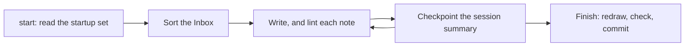

<!--
title: '🔄 SESSIONS & THE MEMORY CASCADE'
description: 'What an agent does from a session''s first read to its last commit, which session helper serves each step and what each one reads and prints, and how update-vault.py moves summaries from Current to Recent to Archive. Read it when you run the helpers, call one from your own tooling, or change how summaries age.'
type: guide
keywords: [startup, checkpoint, summaries, tiers, hooks, helpers, update-vault, current recent archive]
-->

<!-- markdownlint-disable MD041 -->
<div align="center">

# 🔄 SESSIONS & THE MEMORY CASCADE

<a name="top"></a>

**What a session does from its first read to its last commit, and how its summary ages.**

_Two summaries read at the start, none ever deleted._

</div>

---

## 💡 A Session, Start To Finish

[`AGENTS.md`](../../../AGENTS.md) sets the steps, and `.github/scripts/session.py` takes the three a
script can: it lists what to read, checks a note once it is written, and tidies up when the work
stops.



| Step       | What the agent does                                                                                            | Helper                                                       | Set by                          |
| :--------- | :------------------------------------------------------------------------------------------------------------- | :----------------------------------------------------------- | :------------------------------ |
| Start      | Reads `Profile/Working Style.md`, `Memory/Log.md` and the two newest summaries in `Memory/Context/Current/`    | `session.py start`                                           | `AGENTS.md`, Start here         |
| Sort       | Sorts any file waiting at the Inbox before other work, each move with a yes                                    | The card's `INBOX` lines                                     | `Inbox/Inbox.md`                |
| Orient     | Reads the notes of the folders the task touches, with the Rules of each folder note above them, or the catalog | None                                                         | `AGENTS.md`, Start here         |
| Write      | Writes each note in its folder's format, and lints it                                                          | `lint-notes.py "<note>"`, or `session.py after-edit`         | `AGENTS.md`, Commands           |
| Record     | Records in Memory and the Log what happened, was decided or is due, without being asked                        | None                                                         | `AGENTS.md`, Overrides          |
| Checkpoint | Updates the running session summary after each finished task, and writes one before the context runs short     | None                                                         | `Memory/Memory.md`, Rules       |
| Finish     | Redraws what is generated, runs every check, commits, and leaves pushing to the owner                          | `update-vault.py` and `check-vault.py`, or `session.py stop` | `AGENTS.md`, Definition of done |

---

## 🚀 The Start Card

`session.py start` prints paths to read, never their contents, so the card stays short. This is the
template's own card, with no summary written yet and nothing waiting:

```text
Vault startup (AGENTS.md, Start here). The startup set is listed, not inlined:
Read every file on a READ line before substantive work.
READ Profile/Working Style.md
READ Memory/Log.md
No session summaries in Memory/Context/Current yet.
Inbox clear.
```

- **`READ` lines** name the startup notes, `STARTUP` in `.github/scripts/vault.py`, stable before
  volatile, then up to two summaries from `Memory/Context/Current/`, newest first by file name,
  skipping any marked `deprecated` or `archived`.
- **`INBOX` lines** name each loose file outside the held sub-homes (`Reports/`, `Visuals/`, `Ideas/`,
  `Faculties/` and `Backups/`), then say how many wait and that they are sorted before other work.

---

## 🤖 The Helpers' Contract

The helpers began as the vault's Claude Code hooks. The vault carries no agent configuration now, so
nothing wires them: run each by hand, or call one from an agent's own hook settings. Every helper
exits 0 whatever happens, so a helper never breaks a session.

| Helper       | Reads                                                                                                          | Does                                                                                                                                                      | Prints                                                                                                                                                         |
| :----------- | :------------------------------------------------------------------------------------------------------------- | :-------------------------------------------------------------------------------------------------------------------------------------------------------- | :------------------------------------------------------------------------------------------------------------------------------------------------------------- |
| `start`      | The vault                                                                                                      | Lists the startup set and the Inbox                                                                                                                       | The card above                                                                                                                                                 |
| `after-edit` | JSON on standard input naming the file just written at `tool_input.file_path`, from the vault root or absolute | Runs `lint-notes.py` on a Markdown file, and `check-skills.py` on a file inside a skill source; skips a path outside the vault and input that is not JSON | Nothing when the file passes; otherwise `{"hookSpecificOutput": {"hookEventName": "PostToolUse", "additionalContext": "..."}}`, holding each script's findings |
| `stop`       | `git status`                                                                                                   | Only when the working tree has changes, or git cannot tell: runs `update-vault.py`, which writes, then `check-vault.py`                                   | Nothing when all is well; otherwise `{"systemMessage": "..."}`, naming up to five redrawn parts and the first problems                                         |

```bash
python3 .github/scripts/session.py start
echo '{"tool_input": {"file_path": "Memory/Log.md"}}' | python3 .github/scripts/session.py after-edit
python3 .github/scripts/session.py stop
```

---

## 📝 Writing The Session Summary

- **When.** After each finished task, update the running summary, and before the context runs short,
  make sure one is written (`Memory/Memory.md`, Rules).
- **Where.** Copy `Memory/.template/Session Summary.md` into `Memory/Context/Current/` as
  `YYYYMMDD-HHMMSS.md`, the time of filing, so the names sort by time. Give the copy `type: record`,
  its own title and description, and an H1 with an emoji and the date. It carries no wikilinks.
- **What.** A delta update: what still stands, what changed, and what it overrides, each override
  saying in so many words that it supersedes any earlier statement; then the decisions, the open
  questions, the next steps and anything that must be kept word for word. The scaffold has the
  sections.
- **How long.** Short: the two newest summaries are read in full at every start. Keep the active
  changes and the next steps at the top or the bottom, as [Context Assembly](Context-Assembly.md)
  asks.
- **Then** run `python3 .github/scripts/update-vault.py`, which lists the summary in its tier and
  moves the oldest on when the tier is full.

When a new summary overrides an earlier one, mark the earlier one `status: deprecated`: the start
card skips it from then on (`Memory/Context/Current/Current.md`).

---

## 🧊 The Memory Cascade


`update-vault.py` runs the cascade first, before it draws anything else:

- **Oldest by file name.** A tier's summaries are the Markdown files in its folder other than its own
  note, sorted by name, so `YYYYMMDD-HHMMSS.md` names put the oldest first. While a tier holds more
  than its cap, its oldest moves down one tier.
- **Into the year it names.** From Recent, a summary moves to `Memory/Context/Archive/<year>/`, the
  year read from the first four characters of its name, or `undated` when they are not digits.
- **Never over another file.** A name already taken where it lands gets `-1`, `-2` and so on.
  Nothing is overwritten or deleted.
- **Lists redrawn.** `Current.md` and `Recent.md` each list their summaries in a
  `brain:tier-summaries` block, redrawn on the same run. The Archive keeps no generated list: it is
  reached by search, and a year may carry a `<year> Digest.md` that links to its summaries, never
  replacing them (`Memory/Context/Archive/Archive.md`).
- **Checked, not moved, in CI.** `update-vault.py --check` moves nothing, and fails while a tier is
  over its cap: `Current holds 4 summaries; its cap is 3`.

The caps are `TIERS` in `.github/scripts/vault.py`, and the tier notes state them for the reader, so a
change to a cap changes both. Recent and Archive are read on request, ranked by recency, importance
and relevance, so an important summary stays within reach however far it has moved
(`Memory/Memory.md`).

---

## 🌿 Ending Cleanly

A session is done when `check-vault.py` passes, `update-vault.py` has nothing left to redraw, every
note written carries the schema, the change is committed, and the owner knows which files changed and
what is not yet committed (`AGENTS.md`, Definition of done). `session.py stop` runs the redraw and the
checks in one step, but commits nothing: the commit is the agent's, and the push the owner's.

---

<div align="center">

**Read the card, checkpoint at every boundary, and finish on a commit.**

[↑ Back to Top](#top)

<br />

Built with ❤️ by the Engineering Team. Distributed under the terms in [LICENSE](/LICENSE).

</div>
