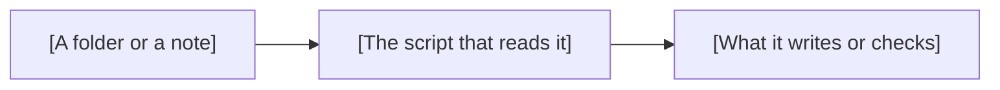

<!--
title: '📐 [THE DESIGN, FULLY CAPPED]'
description: 'The form for designing a change to the vault''s own machinery before it is built, such as a new folder, rule, script or workflow: its parts, the notes and fields it changes, its privacy, its checks and how existing notes and vaults take it. Copy it to .docs/technical/designs/.'
type: 'template'
keywords: ['[a search term not in the title]', '[another name for the change]', 'template']
-->

<!-- On copying: copy this file to .docs/technical/designs/[Short-Slug].md, naming it in Capitalized-Kebab, to design a change to the vault's own machinery, such as a new folder, rule, script or workflow, before it is built. Research for the owner's own life or a venture is a report held in Inbox/Reports/, never a design here. Set type to 'record'. Replace every [bracketed] placeholder: the title and the H1 alike, with the design's name fully capped, the description with one of the design's own, the one-line summary, the tagline and the closing phrase; give it up to eight lowercase keywords not already in the title, without 'template'. Delete a section that does not apply. Keep the design current as it changes, and record each decision that changes the vault's design as an ADR in .docs/adrs/, linked here. If .docs/technical/designs/ does not exist yet, make it with its own README.md, as .docs/technical/README.md says. Delete this note from the copy. -->

# 📐 [THE DESIGN, FULLY CAPPED]

**[One line: the change this design proposes, and what it is for.]**

_[A principle of this design's own, shorter than the line above.]_

---

## 📝 Abstract

[What the change is and why it is needed, in two or three sentences.]

---

## 🎯 Goals & Non-Goals

- **Goals**: [What the design must achieve]
- **Non-Goals**: [What it deliberately leaves alone, so the review stays on the design]

---

## 🧩 The Design

[The parts the change adds or changes, such as folders, notes, scripts and workflows, and how they
fit together.]

---

## 🗂️ Notes & Fields

- **Folders and notes**: [The folders and notes it adds, moves or changes]
- **Frontmatter**: [The fields it adds or changes. A change to the note schema reaches every note in
  the same commit, as the [Note Schema](/.docs/technical/vault/Note-Schema.md) says]
- **Generated parts**: [The blocks `update-vault.py` draws, the catalog records or the folder logs
  it changes]

---

## ⌨️ Commands & Files

- `[The command, with its arguments]`: [What it reads, what it writes, and what it exits with]

---

## ⚖️ Alternatives Considered

| Alternative | Why it was not chosen             |
| :---------- | :-------------------------------- |
| [Option B]  | [The trade-off that ruled it out] |
| [Option C]  | [The trade-off that ruled it out] |

---

## 🔒 Privacy & Secrets

- **Personal data**: [What it reads or writes about the owner or anyone else, and where that stays]
- **Secrets**: [Any it needs, each named by where it is kept, never stored, as
  [Personal Data & Secrets](/.docs/operations/Personal-Data-&-Secrets.md) says]
- **What leaves the vault**: [Anything sent outside the repository, or nothing]

---

## ✅ Checks

- [How `lint-notes.py`, `check-links.py`, `scan-pii.py` and `check-vault.py` hold the change]
- [The tests it adds beside the scripts, as `.github/scripts/test_*.py`]

---

## 🛫 Rollout

- **Notes already written**: [How they take the change, in the same commit]
- **Vaults made from the template**: [How each takes the change through 🔄 Template Sync, and
  whether it breaks one and needs a new major release; delete this line in a vault of its own]
- **Undo**: [How to reverse it: revert the pull request, or restore the files from git]

### 🔗 See also

> [!TIP]
> [Vault Scripts](/.docs/technical/Vault-Scripts.md) says how the scripts fit together, and an
> [Implementation Plan](/.docs/templates/Implementation-Plan.md) carries a design out. Every
> canonical guide is indexed in the
> [&#x1F4DA; Standards Index](https://github.com/tannergolden/standards/blob/Development/docs/README.md).

---

**[A closing phrase of this design's own.]**

[↑ Back to Top](#top)

 

Built with ❤️ by the Engineering Team. Distributed under the terms in [LICENSE](/LICENSE).

