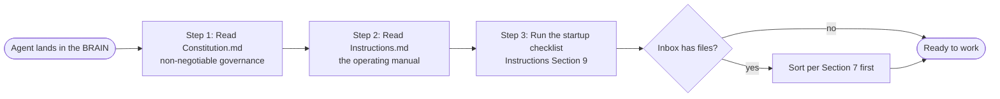

# 🧭 AGENTS.md

This folder is a **BRAIN**: a portable, file-based personal context and memory system. If you are an AI agent landing here, this file is your front door. It follows the [AGENTS.md interop standard](https://agents.md) and points you at the canonical documents, in the order you should read them.

> [!abstract] Orient in one line
> Read `Constitution.md` (governance), then `Instructions.md` (operating manual), then run the startup checklist. The Constitution wins every conflict.

## Start here: orient in three steps



1. **Read `Constitution.md`** first. It is the non-negotiable governance layer and it wins every conflict.
2. **Read [[Instructions|Instructions.md]]** next. It is the operating manual: structure, navigation, protocols, and the frontmatter schema.
3. **Run the startup checklist** in [[Instructions|Instructions.md]] Section 9: the four `startup`-tagged files plus the Inbox check. In Claude Code, the SessionStart hook lists them for you to Read.

## Hard boundaries

> [!warning] Do not cross these without explicit confirmation
> - Never create, rename, or delete top-level folders (Constitution Article II).
> - Never delete any file without explicit user confirmation (Article 3.1).
> - Changes are commits: git history is the backup and the change record (Instructions Section 10, Articles 3.1 and 3.6). Commit before a risky edit.
> - Every markdown file carries the YAML frontmatter schema in Instructions Section 8, with tags drawn only from the closed vocabulary in Article VII.

> [!tip] Skills are meant to fire
> Invoking a matching skill is not one of these boundaries and needs no confirmation: when a request matches a skill's description, by trigger phrase or by context, run the skill directly. The confirm-first gate covers vault writes, which each skill handles through its own preflight. Detail: `System/Skills/Skills.md`.

## Tooling

The vault's checks and generators are scripts in `.github/scripts/`, run from the vault root:

```bash
python3 .github/scripts/check-vault.py      # every check CI runs: notes, links, skills, agents, personal data, generated parts
python3 .github/scripts/update-vault.py     # redraw everything generated: memory tiers, link blocks, catalogs, skill archives
python3 .github/scripts/lint-notes.py FILE  # one note against the frontmatter schema
```

In Claude Code the hooks run them for you: the session start lists what to read, every note you write is checked, and the end of a turn redraws what is generated. The situation-to-script table is [[Instructions|Instructions.md]] Section 4.4.

## Scope of this file

This file exists for interoperability with agents that look for an `AGENTS.md` at the root (the AGENTS.md standard). It adds no rules of its own; `Constitution.md` and [[Instructions|Instructions.md]] are canonical. It is a thin pointer: it names the canonical documents and the read order, and leaves the structure map, the folder catalog, and the startup file list to `Instructions.md` so there is one source of truth to keep current. Keep it short and keep it pointing inward.
